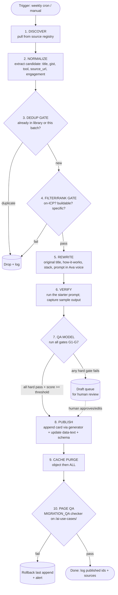

# AI Use-Case Pipeline — Process Flow, Requirements & QA Model

**Purpose:** a fully-specified, automatable pipeline that harvests real AI use cases, makes them Ava's own, and publishes them to `/ai-use-cases/` — with a QA model strong enough that **anything that reaches "publish" is always publish-ready.** Companion to [AI_USECASE_HARVEST.md](AI_USECASE_HARVEST.md) (sourcing strategy) and [MIGRATION_QA.md](MIGRATION_QA.md) (page-level gate reused at the end).

**Design guarantee:** the live site never receives a broken or off-brand card. The worst a bad batch can do is publish **fewer** items (or zero) — never a bad one. Every item must clear every hard gate; anything short drops to a draft queue for a human.

---

## 1. Process flow



**Stage summary**
| # | Stage | In | Out |
|---|---|---|---|
| 1 | Discover | source registry | raw items |
| 2 | Normalize | raw items | candidate records |
| 3 | Dedup gate | candidate + library index | unique candidates |
| 4 | Filter/Rank gate | unique candidates | on-ICP, ranked shortlist |
| 5 | Rewrite ("make ours") | shortlist | drafted cards (original copy) |
| 6 | Verify | drafted cards | cards + sample prompt output |
| 7 | QA model | verified cards | pass → publish; fail → draft queue |
| 8 | Publish | passed cards | updated page content |
| 9 | Cache purge | — | fresh render |
| 10 | Page QA | live page | confirmed or rollback |

---

## 2. Requirements

### 2.1 Functional (per stage)
- **Discover:** read a **source registry** (list of sources + type: feed/subreddit/search/gallery). Respect robots.txt and each source's rate limit. Capture `source_url`, `source_name`, `fetched_at`, and an `engagement` signal (upvotes/likes) where available.
- **Normalize:** reduce each raw item to `{gist, tool_hint, source_url, engagement}`. No full-text copying beyond a short gist used internally.
- **Dedup:** compare against the **library index** (all live cards) and the in-batch set, by (a) normalized-title match and (b) semantic similarity ≥ 0.85 → duplicate.
- **Filter/Rank:** an LLM classifier labels `on_icp` (bool), `buildable` (bool), `specific` (bool), and `category` (one of the 7). Rank survivors by `engagement × specificity`. Take top N (default 5).
- **Rewrite:** generate original `title`, `one_liner`, `how`, `stack`, `prompt` in Ava's voice from the gist — **never the source's wording**. Optional `inspired_by` credit.
- **Verify:** execute `prompt` against the model with placeholder sample values; store `sample_output`.
- **Publish:** append the card through the existing generator (`build_usecases*.py` card model), keep `data-text` and the ItemList schema in sync, set `template=elementor_canvas`, clear Elementor meta, purge caches.

### 2.2 Data model (one record)
```json
{
  "id": "uc_<hash>",
  "category": "lead|marketing|content|sales|ops|seo|cs",
  "title": "", "one_liner": "", "how": "", "stack": "", "prompt": "",
  "ig_url": null,
  "source_name": "", "source_url": "", "inspired_by": null,
  "engagement": 0,
  "sample_output": "",
  "scores": { "icp": 0, "buildable": 0, "specific": 0, "original": 0, "safety": 0, "prompt_quality": 0 },
  "status": "draft|queued|published|rejected",
  "title_hash": "", "semantic_vec_ref": "",
  "created_at": "", "published_at": null, "page_id": 24305
}
```
State lives in a **JSON store in the repo** (e.g. `data/usecases/*.json`) or a small DB — the source of truth for dedup and the library index. Credentials never committed (public-URL fetch + the WP app password stays in env/secret manager).

### 2.3 Non-functional
- **Idempotent:** re-running a batch publishes nothing new (dedup + record status).
- **Rate & cost caps:** per-source request ceiling; per-run LLM token/$ cap; hard stop on exceed.
- **Observability:** structured log per run (discovered / deduped / filtered / drafted / verified / published / rollback), with source attribution.
- **Reversible:** every publish is a single card append → rollback = remove that card + re-purge (stage 10 does this on page-QA failure).
- **No PII / no fabricated claims** enforced at QA (G5), not just by convention.
- **Attribution/ethics:** discovery only; original output; honor source terms; no verbatim republishing.

---

## 3. QA model (the always-publishable guarantee)

Each candidate is scored 0–1 on six dimensions and must clear **hard gates**. **Publish only if every hard gate passes AND weighted score ≥ 0.80.** Otherwise → draft queue.

| Gate | Type | Pass criteria | How checked |
|---|---|---|---|
| **G1 On-ICP** | hard | useful to a local/SMB in marketing/front-desk/sales/ops/content/local-SEO | LLM classifier label + confidence ≥ 0.7 |
| **G2 Buildable & specific** | hard | a concrete task with a clear trigger → AI step → action; we could deliver it | classifier + stack sanity (tools exist/integrate) |
| **G3 Originality** | hard | title & body **not** a near-copy of the source (similarity < 0.6 vs source text) | embedding similarity vs captured gist/source |
| **G4 Prompt verification** | hard | running `prompt` yields a coherent, on-task, safe result; no errors/refusals | execute prompt, LLM-judge the `sample_output` on-task ≥ 0.7 |
| **G5 Safety & brand** | hard | no PII, no fabricated metrics/claims, no disallowed content, on Ava voice | rules + LLM-judge voice/safety |
| **G6 Dedup** | hard | not already in the live library (title + semantic) | library index check |
| **G7 Technical/SEO** | hard | all card fields present, valid category, `data-text` synced, valid card HTML, ItemList schema valid; **after publish**, `/ai-use-cases/` passes the [MIGRATION_QA.md](MIGRATION_QA.md) checker | field validation + page QA checker |
| **Score** | soft | weighted mean of the six `scores` ≥ 0.80 | weighted sum |

**Weights (soft score):** icp .20 · buildable .20 · specific .15 · original .15 · safety .15 · prompt_quality .15.

**Decision rule**
```
publish  if  all(hard gates pass)  and  weighted_score >= 0.80
queue    otherwise  (draft for human; never auto-published)
```

**Autonomy ramp (how it becomes "always publishes" safely)**
1. **Phase 1 — assisted:** pipeline drafts; a human approves the batch. (Start here.)
2. **Phase 2 — supervised auto:** auto-publishes items that clear the bar; human reviews a daily digest, can pull any card. Promote after **3 consecutive batches with zero human reversals.**
3. **Phase 3 — autonomous:** publishes on the bar alone; weekly spot-audit only. Any G1–G7 miss found in audit demotes to Phase 2.

Because stage 10 re-runs the page QA checker and **rolls back on failure**, a bad publish can't persist even in Phase 3.

---

## 4. Implementation plan (build order)
1. **State store + library index** — JSON in repo; seed it from the current 18 cards.
2. **Harvester** — source registry + fetchers (WebSearch/WebFetch now; add Reddit/X APIs later). Emits candidate records.
3. **Classifier/ranker** (G1/G2) — LLM call → labels + scores.
4. **Rewriter** (stage 5) — LLM → original card fields in Ava voice.
5. **Verifier** (G4) — run prompt, capture output.
6. **QA runner** (G1–G7 + score) — the gate; writes `status`.
7. **Publisher** — reuse `build_usecases*.py` to append + purge + page-QA + rollback.
8. **Scheduler** — weekly cron (the `schedule` skill / scheduled-tasks, or the `ava-digital-agents` orchestrator once proven).
9. **Digest + queue UI** — a simple report of what published / what's queued for human review.

**Reuse:** the publish + page-QA tail already exists (`build_usecases2.py` + `qa_check.py`). Stages 1–7 are the new work; 8–10 are wiring.

## 4a. The Instagram loop (distribution)
The website use-case library is the **hub and source of truth**; Instagram is downstream distribution that links back.
```
harvest → QA'd page at /ai-use-cases/[slug]/  (full prompt + steps + guardrail live here)
        → Instagram agent reads the published cards
        → generates a Reel/carousel per use case
        → posts to IG with "full prompt on our site →" + link to that page
        → the page embeds the matching Reel (autoplay/muted/loop), closing the loop
```
- **Direction:** site first, social second. Never publish the prompt only to IG — the page is the permanent, indexable home; the post is the ad for it.
- **Per card fields that serve this:** `ig_url` (the published Reel/post, embedded on the page) and the page URL (dropped into the caption / link-in-bio).
- **Handoff:** once a card is live, hand the IG agent `{slug, title, one_liner, page_url, prompt}`; it produces the Reel + caption ending in "Full prompt on our site: avadigitalagency.com/use-cases/[slug]". (Posting tooling: Zernio/postiz.)

## 5. Metrics
- Items discovered → published ratio (funnel health).
- Human-reversal rate (drives the autonomy ramp).
- Index coverage per category (keep the 7 categories balanced).
- Organic impressions / AI-citation mentions for `/ai-use-cases/` (the point of it all).
